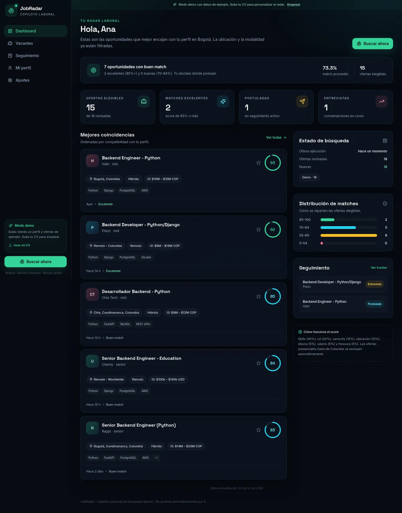
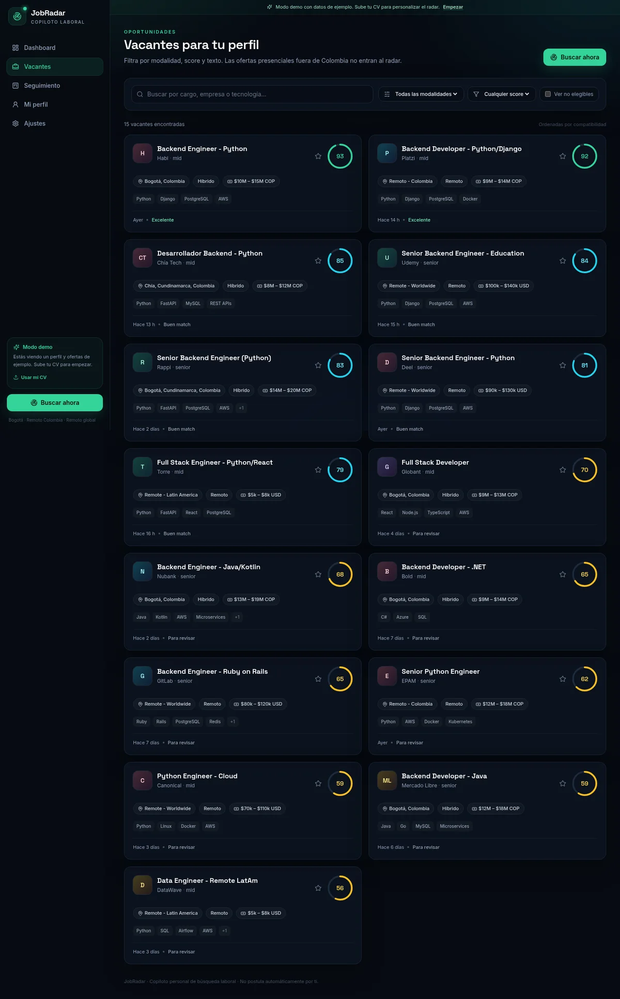
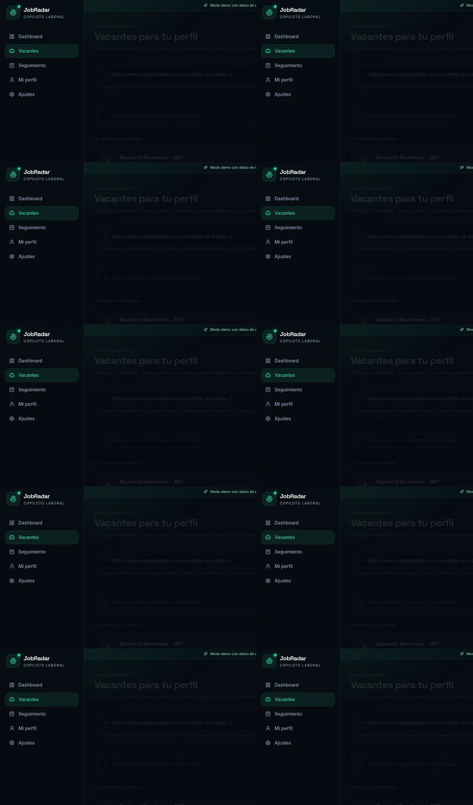
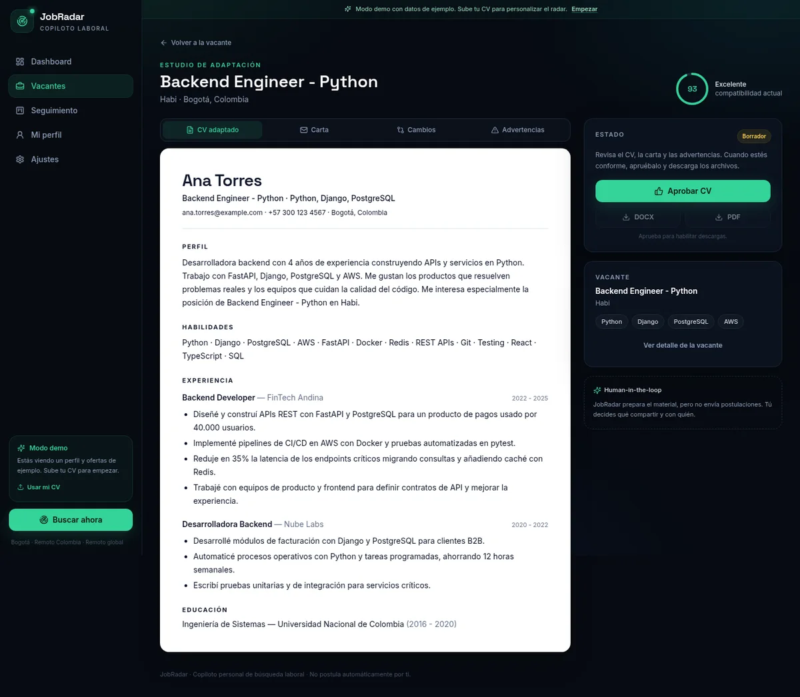

# JobRadar

**Copiloto personal de búsqueda y postulación laboral.**

JobRadar convierte tu CV en un perfil estructurado, busca ofertas compatibles, las puntúa con una explicación y te ayuda a adaptar el CV a cada vacante. Está pensado para una persona ubicada en Bogotá, Colombia: prioriza presencial/híbrido en Bogotá y su área metropolitana, acepta remoto nacional y solo acepta remoto para ofertas fuera de Colombia.

> JobRadar no scrapea LinkedIn/Indeed ni evade CAPTCHA, 2FA o sistemas anti-bot. En portales restringidos solo importa la vacante y te lleva al enlace original. En portales compatibles ofrece un asistente con revisión humana y, si lo activas, auto-envío opcional mediante una extensión local de Chrome.



## Qué hace

- **Perfil desde el CV:** extrae nombre, contacto, skills, experiencia, educación e idiomas de PDF, DOCX, TXT o Markdown. Si no hay LLM configurado, usa heurísticas locales.
- **Búsqueda con reglas de ubicación:** Bogotá y ciudades cercanas para presencial/híbrido; resto de Colombia solo con reubicación; fuera de Colombia solo remoto.
- **Match explicable:** score de 0 a 100 con desglose por skills, rol, seniority, ubicación, idioma, salario y frescura. Cada resultado incluye razones, brechas y señales de alerta.
- **Importar una vacante por URL:** pega el enlace público de cualquier oferta y JobRadar extrae título, empresa, ubicación, salario y descripción desde schema.org/OpenGraph, calcula el match y conserva el enlace original para postular en el portal.
- **CV adaptado por vacante:** reescribe el resumen, prioriza skills y reordena experiencia usando solo información real del perfil. Genera DOCX y PDF después de tu aprobación.
- **Asistente de postulación:** prepara los campos, redacta respuestas y adjunta el CV elegido. En portales compatibles la extensión de Chrome rellena el formulario; tú revisas y confirmas el envío.
- **Auto-envío opcional:** desactivado por defecto. Tiene un interruptor en **Vacantes** y en **Ajustes**. Cuando lo activas, procesa en orden solo portales permitidos (Greenhouse, Lever, Ashby, Workable, Breezy y Teamtailor) y deja las demás vacantes como cartas manuales con descripción y enlace original.
- **Portales restringidos:** LinkedIn, Indeed, Computrabajo, Magneto, elempleo y Glassdoor son solo manuales: se muestra la vacante y se abre el portal original, sin autocompletado ni envío.
- **Frescura y descarte:** filtros de 24 h, 48 h (por defecto), 7 días o todo; las vacantes sin fecha se excluyen por defecto. Puedes descartar una vacante para que no reaparezca en búsquedas ni rondas de auto-envío.
- **Tracker de postulaciones:** columnas Guardadas, Postuladas, Entrevistas, Ofertas y Rechazadas.
- **Alertas por Gmail:** correo inmediato para matches excelentes y resumen diario para los buenos.
- **Modo demo:** funciona sin claves, sin red y sin datos reales. Ideal para probar la experiencia o mostrarla en un portafolio.





## Demo

- `DEMO_MODE=true` carga un perfil de ejemplo y **18 ofertas curadas** (15 elegibles).
- No requiere claves de LLM, correo ni APIs externas.
- Los correos reales se desactivan en modo demo.
- El botón **Reiniciar demo** de Ajustes restaura perfil, ofertas y postulaciones de ejemplo.

## Stack

- **Backend:** Python 3.12, FastAPI, SQLAlchemy, SQLite, APScheduler.
- **Frontend:** React 19, Vite, TypeScript, Tailwind CSS, TanStack Query, React Router, Sonner.
- **IA:** OpenRouter con modelos gratuitos de NVIDIA Nemotron (opcional). Sin clave funciona con heurísticas y plantillas.
- **Extensión:** Chrome Manifest V3, sin dependencias externas y sin funciones de evasión.
- **Correo:** SMTP de Gmail con contraseña de aplicación (opcional).
- **Fuentes:** JSearch, Jooble, Remotive, RemoteOK, búsqueda web opcional con Brave Search y dataset demo.

## Inicio rápido

### Requisitos

- Python 3.12+
- Node.js 20+
- `uv` (recomendado) o `pip`

### Backend

```bash
cd backend
cp .env.example .env
uv sync --extra dev
uv run uvicorn app.main:app --reload --port 8000
```

La API queda en `http://localhost:8000`. Documentación interactiva en `http://localhost:8000/docs`.

### Frontend

```bash
cd frontend
npm install
npm run dev
```

La app queda en `http://localhost:5173`. Vite proxya `/api` hacia el backend.

También puedes usar:

```bash
make install   # instala backend y frontend
make backend   # API con reload
make frontend  # Vite
make test      # pytest
make lint      # ruff + build de TypeScript
```

## Variables de entorno

Copia `backend/.env.example` a `backend/.env` y completa solo lo que quieras usar. La guía paso a paso está en [`docs/CONFIGURACION.md`](docs/CONFIGURACION.md).

| Variable | Descripción |
|---|---|
| `DEMO_MODE` | `true` carga datos de ejemplo y desactiva correos reales. |
| `DATABASE_URL` | Por defecto SQLite en `data/jobradar.db`. |
| `LLM_API_KEY` / `OPENROUTER_API_KEY` | Clave de OpenRouter (cualquiera de las dos). Si están vacías, usa fallback heurístico y plantillas. |
| `LLM_BASE_URL` | Por defecto `https://openrouter.ai/api/v1`. |
| `LLM_MODEL_FAST` | Modelo rápido para analizar CV y ofertas (por defecto `nvidia/nemotron-3.5-lightning:free`). |
| `LLM_MODEL_QUALITY` | Modelo de calidad para adaptar el CV (por defecto `nvidia/nemotron-3-ultra-550b-a55b:free`). |
| `LLM_MODEL_FALLBACK` | Modelo de respaldo (por defecto `nvidia/nemotron-3.5-super-vl:free`). |
| `AUTO_SUBMIT_ENABLED` | Valor inicial de referencia (por defecto `false`). La activación por usuario se hace con el interruptor de Vacantes o Ajustes. |
| `AUTO_SUBMIT_MAX_PER_RUN` | Máximo de vacantes por ronda (por defecto 5). |
| `AUTO_SUBMIT_PORTALS` | Lista de ATS permitidos para auto-envío. |
| `MANUAL_ONLY_PORTALS` | Portales que nunca se asisten ni se envían automáticamente. |
| `DEFAULT_CV_SOURCE` | `tailored` (CV adaptado ATS) u `original` (PDF original). |
| `FRESHNESS_DAYS` | Frescura por defecto del listado (por defecto 2 días). |
| `JSEARCH_API_KEY` | RapidAPI JSearch (ofertas en Colombia). Plan gratuito: ~200 solicitudes/mes; cada búsqueda consume 1. |
| `JOOBLE_API_KEY` | Jooble Colombia (clave de `co.jooble.org/api/about`). El plan gratuito da 500 solicitudes por clave **en total**, no mensuales. |
| `BRAVE_SEARCH_API_KEY` | Opcional. Búsqueda web de vacantes públicas vía Brave Search (tiene plan gratuito). |
| `SMTP_USER` / `SMTP_PASSWORD` | Gmail + contraseña de aplicación. |
| `ALERT_TO` | Correo que recibe las alertas. |
| `ALERT_THRESHOLD` | Score mínimo para alerta inmediata (por defecto 85). |
| `DIGEST_THRESHOLD` | Score mínimo para el resumen diario (por defecto 70). |
| `DIGEST_HOUR` | Hora del resumen diario, en la zona horaria configurada (por defecto 8). |
| `ENABLE_SCHEDULER` | Activa búsquedas periódicas y resumen diario. |
| `SEARCH_INTERVAL_HOURS` | Frecuencia de búsqueda automática (por defecto 6). |
| `TIMEZONE` | Zona horaria del programador (por defecto `America/Bogota`). |

> **Proveedor de IA:** JobRadar usa únicamente **OpenRouter**. Los IDs `nvidia/...` son el namespace de modelos de NVIDIA dentro de OpenRouter; no se usa la API directa de NVIDIA ni se requiere una segunda clave. Los tres modelos elegidos son las variantes `:free` que aparecen en el grupo de OpenRouter.

### Gmail

1. Activa la verificación en dos pasos en tu cuenta de Google.
2. Ve a **Seguridad → Contraseñas de aplicaciones**.
3. Crea una contraseña para "JobRadar".
4. Usa esa contraseña en `SMTP_PASSWORD` (no tu contraseña normal).

Con SMTP configurado y `DEMO_MODE=false`:

- Un match con score ≥ `ALERT_THRESHOLD` dispara un correo inmediato después de cada búsqueda (manual o programada).
- Un resumen diario agrupa los matches entre `DIGEST_THRESHOLD` y `ALERT_THRESHOLD` que aún no hayas guardado o postulado. Este resumen requiere `ENABLE_SCHEDULER=true`.
- **Ajustes → Integraciones → Probar correo** permite comprobar SMTP incluso en modo demo.

## Flujo

1. Sube tu CV en PDF o DOCX.
2. Revisa el perfil y configura roles, ubicación, salario y modalidad.
3. JobRadar busca ofertas y calcula el match. También puedes pegar el enlace público de una vacante con **Importar por URL**.
4. Revisa el dashboard y el detalle de cada vacante.
5. Adapta el CV, revísalo y descarga DOCX/PDF.
6. Abre **Preparar postulación**, elige **CV adaptado ATS** o **PDF original** y revisa los datos.
7. Pulsa **Abrir portal con asistente** para que la extensión rellene el formulario, o **Abrir portal original** para hacerlo manualmente.
8. Revisa y envía. En portales permitidos puedes activar **Realizar auto-envío** desde Vacantes.
9. Marca o confirma la postulación en el tracker.



## Asistente de postulación y auto-envío

JobRadar clasifica cada portal antes de actuar:

| Modo | Portales | Comportamiento |
|---|---|---|
| `manual_only` | LinkedIn, Indeed, Computrabajo, Magneto, elempleo, Glassdoor | Solo importa/muestra la vacante y abre el enlace original. Sin autocompletado ni envío. |
| `assisted` | Portales y ATS desconocidos | La extensión rellena campos y respuestas; tú revisas y confirmas el envío. |
| `auto_submit` | Greenhouse, Lever, Ashby, Workable, Breezy, Teamtailor | Relleno y envío automático **solo si** activaste el auto-envío en Ajustes. |

El auto-envío es opt-in, secuencial y limitado por ronda. La ronda prioriza portales ATS permitidos y usa los cupos restantes para mostrar cartas manuales con descripción y URL original. La extensión se detiene y marca la vacante como manual si encuentra login, CAPTCHA, 2FA, términos obligatorios o un flujo que no reconoce.

### Instalar la extensión

1. Arranca backend (`http://127.0.0.1:8000`) y frontend (`http://127.0.0.1:5173`).
2. Abre `chrome://extensions` y activa **Modo de desarrollador**.
3. Pulsa **Cargar descomprimida** y selecciona la carpeta `extension/`.
4. Fija la extensión en la barra si quieres abrir el panel manualmente con su icono.

La extensión usa tu sesión real del navegador. No guarda contraseñas de portales, no evade CAPTCHA/2FA ni intenta ocultar la automatización. Los formularios son heurísticos: iframes, flujos multi-dominio y validaciones personalizadas pueden requerir que completes el último paso a mano. Más detalles en [`extension/README.md`](extension/README.md).

## Frescura y descarte

- El listado muestra por defecto las últimas **48 horas**, ordenadas de más reciente a más antigua.
- Puedes cambiar a 24 h, 7 días o todo, e incluir vacantes sin fecha si lo necesitas.
- La importación manual por URL **no** se bloquea por frescura.
- **Descartar** usa un borrado lógico: la vacante desaparece de búsquedas y rondas de auto-envío, y no reaparece si se vuelve a importar. Puedes restaurarla desde su detalle.

## Reglas de ubicación

- Presencial/híbrido en Bogotá o ciudades cercanas: elegible.
- Remoto en Colombia: elegible.
- Presencial/híbrido en otra ciudad de Colombia: solo si aceptas reubicarte.
- Remoto en LatAm o global: elegible si la zona horaria es compatible.
- Presencial/híbrido fuera de Colombia: excluido.

## Cobertura de fuentes

JobRadar no scrapea portales que prohíben el acceso automatizado ni intenta saltarse inicios de sesión. La estrategia es:

- APIs oficiales o agregadores: JSearch, Jooble, Remotive y RemoteOK.
- Búsqueda web opcional con Brave Search, limitada a páginas públicas y portales que publican datos estructurados (`JobPosting`).
- Importación manual por URL para cualquier oferta pública que puedas abrir en tu navegador.

Por eso no promete "todas las vacantes de internet": promete traer las que sean accesibles de forma legítima y darte el enlace para postular en el portal original.

## Privacidad

- La base de datos, los CVs subidos y los archivos exportados viven en `data/`, fuera de Git.
- Las claves se leen desde `backend/.env`; nunca se envían al navegador.
- La extensión guarda solo la URL base de la API en `chrome.storage.local`; no almacena credenciales de portales ni contraseñas.
- JobRadar es una herramienta personal y local. Si la publicas fuera de tu máquina, ponle autenticación en un reverse proxy.

## Estructura

```text
jobradar/
├── backend/
│   ├── app/
│   │   ├── api/        # rutas FastAPI
│   │   ├── core/       # configuración y base de datos
│   │   ├── data/       # dataset demo y catálogo de skills
│   │   ├── models/     # entidades SQLAlchemy
│   │   ├── schemas/    # contratos Pydantic
│   │   └── services/   # coincidencias, fuentes, CV, correo, programador
│   └── tests/
├── frontend/
│   ├── public/
│   └── src/
│       ├── components/
│       ├── lib/
│       └── pages/
├── extension/          # Chrome MV3: relleno asistido y auto-envío opt-in
├── docs/screenshots/
├── data/               # runtime, no versionado
└── Makefile
```

## Tests y calidad

```bash
cd backend && uv run pytest -q
cd backend && uv run ruff check .
cd frontend && npm run build
```

El backend incluye pruebas de reglas de ubicación, motor de coincidencias, endpoints, exportación, resumen de correo, clasificación de portales, sesiones de postulación, auto-envío, frescura y descarte. El frontend se valida con TypeScript estricto y build de producción de Vite. La extensión se valida con `node --check` y el manifiesto con `python -m json.tool`.

## Estado

MVP local completo:

- [x] Perfil, carga y parsing de CV.
- [x] Preferencias, reglas de ubicación y coincidencias explicables.
- [x] Ingesta demo y fuentes externas opcionales.
- [x] Importación de vacantes públicas por URL con JSON-LD/OpenGraph.
- [x] Dashboard, vacantes, detalle y tracker.
- [x] Adaptación de CV con guardrails, aprobación y exportación DOCX/PDF.
- [x] Asistente de postulación con extensión Chrome, CV original/adaptado y revisión humana.
- [x] Auto-envío opt-in para ATS permitidos; portales restringidos permanecen manuales.
- [x] Frescura configurable, descarte/restauración y bloqueo de reaparición.
- [x] Alertas Gmail inmediatas y resumen diario.
- [x] Modo demo offline y datos de ejemplo.
- [ ] Autenticación y despliegue público (fuera del alcance personal).

## Licencia

MIT.
